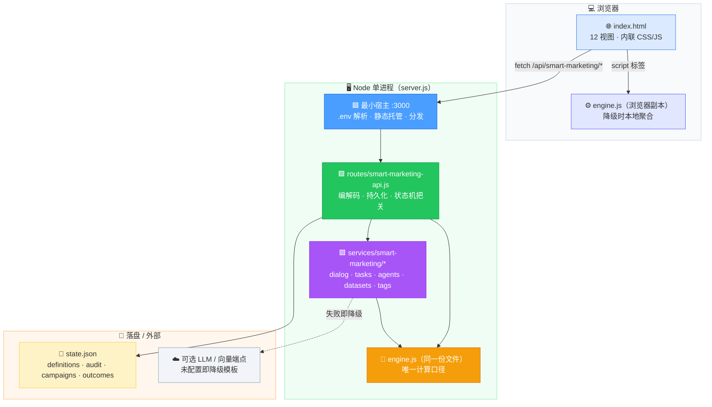
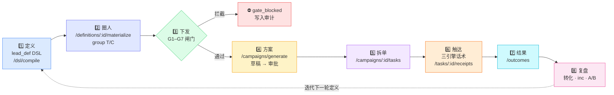
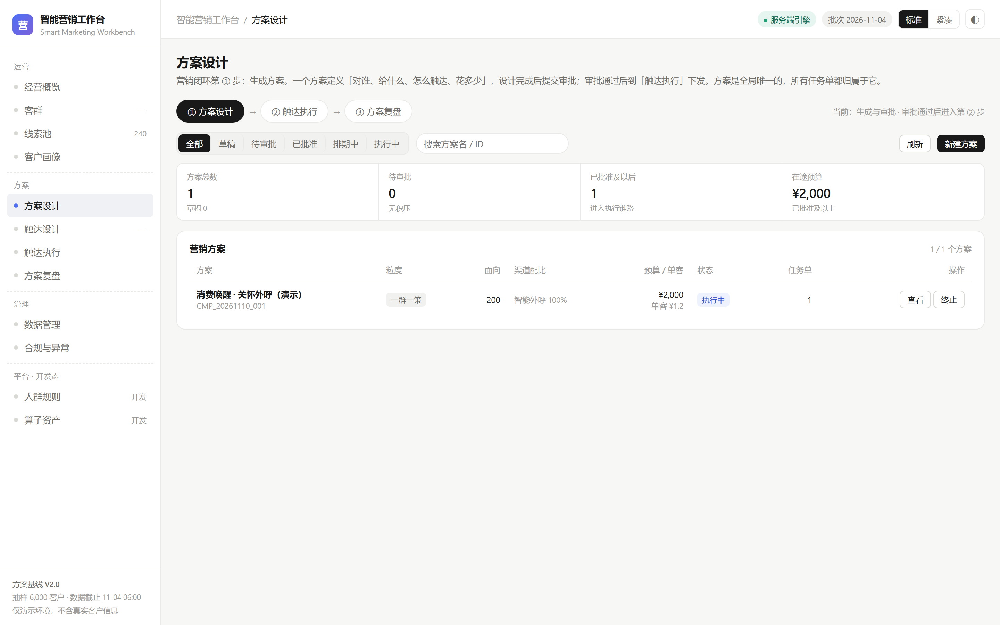
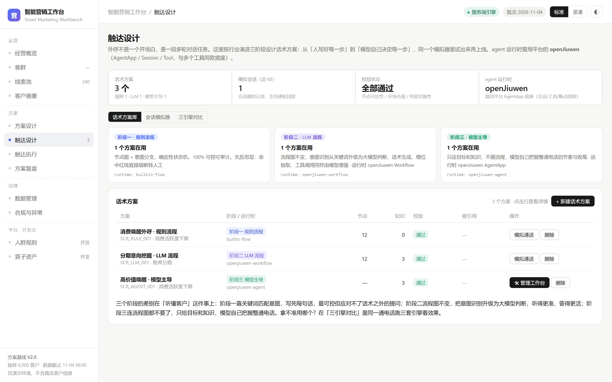
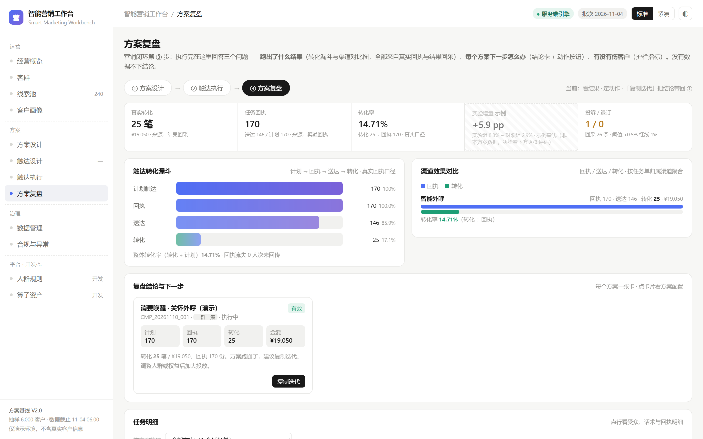

<div align="center">

# 🧭 智能营销工作台

**Smart Marketing Workbench — 线索定义 DSL · 合规闸门 · 任务单回执 · 增量复盘，一条可审计闭环**

把 `圈人 → 方案 → 任务单 → 触达 → 回执 → 复盘` 收敛成一条有版本、有闸门、有留痕的数据链

[](https://nodejs.org/)


**同系列**：[Skill Hub](https://github.com/wanshoulu/Skill-Hub)（Agent 技能全生命周期）· [graph-builder](https://github.com/wanshoulu/graph-builder)（知识图谱 / RSI）· [rag-builder](https://github.com/wanshoulu/rag-builder)（RAG 向量问答）· [llm-wiki-builder](https://github.com/wanshoulu/llm-wiki-builder)（Wiki 双链知识库）

</div>

---

> **智能营销工作台** 原是 AI Harbor 平台的一个分区，现剥离为独立仓库：用线索定义 DSL 圈人，经 G1–G7 合规闸门下发方案与任务单，触达回执回流后按实验/对照组复盘转化增量，所有状态变更写入 sha256 审计链。前后端共用**同一份**规则引擎，零外部依赖、零构建、零数据库，三行命令跑起来。

> **写法参考（实调原文）**：本账号 [Skill-Hub](https://github.com/wanshoulu/Skill-Hub) 的居中头部 + badge + 目录 + emoji 分节 + mermaid 图 + `<details>` 折叠、[rag-builder](https://github.com/wanshoulu/rag-builder) 的截图先行 + 同系列导航 + 名词表折叠 + 四行上手、[graph-builder](https://github.com/wanshoulu/graph-builder) 的四段式简介 + 按目标导航 + 调研留痕；外部范式取 [Ollama](https://github.com/ollama/ollama) 的「两行跑通」、[Mermaid](https://github.com/mermaid-js/mermaid) 的「示例/截图先行」、[Prometheus](https://github.com/prometheus/prometheus) 的「加粗机制名清单 + 架构图」。
>
> **名词原文调研**（不取项目内用法当定义）：DSL 见 [Martin Fowler](https://www.martinfowler.com/bliki/DomainSpecificLanguage.html)、UMD 见 [umdjs/umd](https://github.com/umdjs/umd)、LogicFlow 见 [官网](https://site.logic-flow.cn/)、uplift modeling 见 [NeurIPS 论文](http://papers.neurips.cc/paper/8198-uplift-modeling-from-separate-labels.pdf)。

---

## 📑 目录

- [📌 项目简介](#-项目简介)
- [📖 名词表](#-名词表)
- [✨ 核心特性](#-核心特性)
- [🏛️ 总体架构](#️-总体架构)
- [📦 目录结构](#-目录结构)
- [🚀 快速开始](#-快速开始)
- [🔄 端到端流程](#-端到端流程)
- [🖥️ 工作台预览](#️-工作台预览)
- [🧩 核心组件](#-核心组件)
- [🔧 架构设计要点](#-架构设计要点)
- [📡 API 概览](#-api-概览)
- [⚙️ 配置](#️-配置)
- [✅ 测试](#-测试)
- [⚖️ 设计取舍与代价](#️-设计取舍与代价)
- [⚠️ 已知限制](#️-已知限制)
- [❓ 常见问题](#-常见问题)
- [📚 文档](#-文档)
- [🙏 来源与许可](#-来源与许可)

---

## 📌 项目简介

- **问题域**：银行零售营销的动作散落在 Excel 名单、话术脚本和人工记录里——「谁被圈进来、凭什么给他这个权益、哪一步被合规拦下、转化是活动带来的还是本来就会发生」都无法回放。本工作台把这些环节收敛到一条**有版本、有闸门、有审计、有对照组**的数据链上，让每一步状态变更都能回答「依据是什么」。
- **方案机制**：**线索定义 DSL**（`lead_def:` 编译后实例化客群）、**G1–G7 合规闸门**（下发前拦截，失败返回 `gate_blocked`）、**单源 UMD 引擎**（Node 与浏览器加载同一份 `engine.js`）、**三套状态机**（线索 / 方案 / 任务单）、**回执回流**（`receipts → outcomes → effect`）、**实验/对照组**（`group: 'T' | 'C'`）、**sha256 审计哈希链**、**LLM 全链路降级**（模型不可用时走确定性模板，闭环不中断）。
- **交付物**：`server.js` 单服务入口、1 个单文件前端（12 视图，8,015 行）、1 份共享引擎（1,092 行）、1 组 API 路由（1,797 行）、7 个服务模块、3 个测试文件（89 用例）、架构与 API 文档、4 张真实运行截图。**零 `npm install`、零构建、零数据库**，运行时只用到 Node 内置模块。
- **状态**：从 AI Harbor 平台逐字节抽取的代码快照，原代码一行未改；仅新增最小宿主与文档。数据为确定性种子生成的演示数据（6,000 客户 / 240 线索，`seed=20261104`），健康检查明确返回 `simulated: true`，**不含真实客户信息，不作为经营决策依据**。默认绑定 `127.0.0.1:3000`，无鉴权，**不是生产就绪的多租户服务**。

> 想直接跑 → [快速开始](#-快速开始)｜想看链路 → [端到端流程](#-端到端流程)｜想对字段 → [API 文档](docs/api.md)｜想质疑取舍 → [设计取舍与代价](#️-设计取舍与代价)｜想看坑 → [已知限制](#️-已知限制)

---

## 📖 名词表

先对齐术语，再看机制。带链接的定义来自该术语的官方/原始出处，不是本项目自造的解释。

| 名词 | 含义 |
|---|---|
| `smart-marketing` | 本仓库技术标识，同时是目录名、静态路径 `/tools/smart-marketing/` 与 API 前缀 `/api/smart-marketing/*`；展示名为「智能营销工作台 / Smart Marketing Workbench」。 |
| **DSL**（Domain-Specific Language） | 面向特定问题域、而非通用编程的计算机语言，见 Martin Fowler 的[定义与内外部分类](https://www.martinfowler.com/bliki/DomainSpecificLanguage.html)。本项目用外部 DSL `lead_def:` 描述线索规则，有自定义语法与解析器（`/dsl/compile`）。 |
| **UMD**（Universal Module Definition） | 让同一 JS 模块在浏览器全局、AMD、CommonJS 都能加载的模式，见 [umdjs/umd](https://github.com/umdjs/umd)。`engine.js` 用 UMD 包装，服务端 `require()` 与前端 `<script>` 得到同一份实现。 |
| **LogicFlow** | 滴滴开源的[业务流程图编辑框架](https://site.logic-flow.cn/)。本仓库唯一第三方前端库，用于「触达设计」页话术画布，从 CDN 加载。 |
| **uplift modeling / 因果增量** | 估计「某动作对个体行为的增量影响」的因果机器学习方法，[NeurIPS 论文](http://papers.neurips.cc/paper/8198-uplift-modeling-from-separate-labels.pdf)定义为估计 individual uplift / CATE；标准 A/B 测试只给平均处理效应。**本项目的 `inc` 不是 uplift model**，见下。 |
| **G1–G7 合规闸门** | 本项目内部的七道拦截规则编号（含投诉客户、协商还款中客户、可解释性为 NONE 的算子不得进入对客场景等），**非外部行业标准**。 |
| **T / C 组、sha256 审计哈希链** | 线索 `group` 的实验组/对照组；`routes/smart-marketing-api.js` 用 sha256 串接审计记录，可检测记录被篡改，数组固定保留最近 500 条。 |

<details>
<summary><b>🔍 「因果增量」这个词在本仓库的准确口径</b></summary>

复盘页写的是「因果增量」，实现是 `/metrics` 返回的**实验组与对照组转化率之差 `inc` 及置信区间 `incCI`**，外加渠道效果对比。它没有训练个体级 CATE 模型，没有 Qini 曲线，也没有做倾向得分校正。引用 uplift modeling 的论文定义只是为了说明这个术语的严格含义，避免把组间差误读成因果识别结果——这一条同时列在[已知限制](#️-已知限制)里。

</details>

---

## ✨ 核心特性

| 特性 | 说明 |
|:---:|---|
| 🧬 | **单源规则引擎** — `engine.js` 是唯一计算口径，路由文件头明确「任何复制第二份计算逻辑的改动都视为缺陷」，前后端指标不会漂移 |
| 📐 | **线索定义 DSL** — `scope / trigger / filters[] / scoring[] / threshold / cooldown_days / action / guardrail` 编译后实例化客群，支持试算、名单导入与组合客群 |
| 🛡️ | **G1–G7 合规闸门** — 「已下发」前调用 `gatesOf()` 拦截，失败写 `gate_blocked` 并留痕；投诉客户、协商还款中客户不得进入对客场景 |
| 🔀 | **三套状态机** — 线索 / 方案 / 任务单各自显式迁移，任务单从「已暂停」恢复要校验 `paused_reason === 'complaint_redline'` |
| 📨 | **回执回流** — 任务单 `/receipts` 汇总后自动推进方案状态，`/outcomes` 供复盘页消费，形成可回放闭环 |
| 🧪 | **实验/对照与增量口径** — 线索按 T/C 分流，返回组转化率、`inc` 与置信区间；数据来自确定性种子，结果可复现 |
| 🔗 | **sha256 审计哈希链 + 原子落盘** — 200 ms 防抖 → 写 `state.json.tmp` → `renameSync` 原子替换，避免半文件写入 |
| 🤖 | **三阶段外呼引擎** — `rule` 规则流程 / `llm` 模型生成 / `agent` 模型主导命令，`/scripts/compare` 并排对比，`trace.real` 标记每轮是否用了真模型 |
| 📴 | **本地降级** — `/health` 探活失败时前端回落浏览器内 `E.aggregate()`，计算口径不变、页面仍可演示，只是写入不落盘 |

---

## 🏛️ 总体架构



> **单源引擎**是本仓库的设计核心：浏览器与服务端加载的是 `tools/smart-marketing/engine.js` 这**同一个文件**。好处是降级模式下数字完全一致；代价是引擎内禁用 `document` / `window` / Node 内置模块，且 `rnd()` 调用顺序决定全部数据（详见[架构设计要点](#-架构设计要点)）。

---

## 📦 目录结构

```
smart-marketing/
├── server.js                         🚀 最小宿主：.env 解析 + API 分发 + /tools/* 静态托管（本仓库新增）
├── package.json                      📦 start / test 脚本，无运行时依赖
├── .env.example                      🔑 可选配置项模板，无真实密钥
├── tools/smart-marketing/
│   ├── index.html                    🌐 前端：12 视图 + 内联 CSS/JS（8,015 行）
│   └── engine.js                     🧬 UMD 共享引擎（1,092 行）
├── routes/smart-marketing-api.js     🟩 HTTP 编解码 + 持久化 + 状态机把关（1,797 行）
├── services/smart-marketing/         🟪 7 个服务模块
│   ├── dialog.js                     三阶段对话流程引擎（2,489 行）
│   ├── tasks.js                      方案 / 任务单 / 回执 / 结果状态机（1,296 行）
│   ├── agents.js                     线索解释 / 方案草稿 / 通话质检
│   ├── datasets.js / tags.js         数据集与标签字典
│   └── agent-llm.js / real-llm.js    两处 LLM 适配层
├── config/api-keys.js                🔧 模型路由注册表（密钥一律 env 读取）
├── data/smart-marketing/state.json   💾 演示初始状态；POST /demo/reset 可复位
├── tests/                            ✅ 3 个 node:test 文件，89 用例
└── docs/                             📚 architecture.md / api.md / screenshots/
```

---

## 🚀 快速开始

Node ≥ 18，**不需要 `npm install`**（`package.json` 只提供脚本，运行时零外部依赖）。

### 1️⃣ 启动

```bash
git clone https://github.com/wanshoulu/smart-marketing.git
cd smart-marketing
node server.js
```

打开 <http://127.0.0.1:3000/>（根路径 302 到 `/tools/smart-marketing/`）。右上角显示 **服务端引擎** 即表示 API 已接管。

### 2️⃣ 验证

```bash
curl http://127.0.0.1:3000/api/smart-marketing/health
curl 'http://127.0.0.1:3000/api/smart-marketing/leads?page=1&size=5'
node --test tests/*.test.js
```

`/health` 实测返回 `customers: 6000, leads: 240, simulated: true, persisted: true`。

### 3️⃣ （可选）接真实模型

```bash
cp .env.example .env
# 填入 LLM_DIRECT_BASE / LLM_DIRECT_KEY / LLM_DIRECT_MODEL
PORT=3018 node server.js
```

> ⚠️ 原平台的内部模型网关 `/api/ai-bank/v1/internal/model/v1/chat/completions` **不在本仓库内**。`agents.js` 默认把它指向 `127.0.0.1:3000`，所以在不配置直连、或使用非 3000 端口时，LLM 通路会**静默降级**为确定性模板——闭环照常可跑，但输出不含模型生成内容。详见[配置](#️-配置)。

### 4️⃣ 复位演示

```bash
curl -X POST http://127.0.0.1:3000/api/smart-marketing/demo/reset
```

> 💡 **降级也是一条可用路径**：后端没起来时，前端 `bootstrap()` 会显示「本地降级」并改用浏览器内 `E.aggregate()` 计算，页面照常演示，只是写入不会持久化。别把这两种模式的徽标看混。

---

## 🔄 端到端流程



<details>
<summary><b>📋 三套状态机与闸门细节</b></summary>

| 实体 | 合法迁移 | 把关点 |
|---|---|---|
| **线索** | `待指认 → 已下发 → 已触达 → 已响应 → 已转化 → 已关闭`；任意态可 `→ 已关闭` | `已下发` 前调用 `gatesOf()`；`engine.js` 的 `transitionsOf()` / `setLeadStatus()` |
| **方案** | `草稿 → 待审批 → 已批准 → 排期中 → 执行中 → 已完成`，旁支 `已终止` | `transitionCampaign()`；任务单全结束时由 `tasks.js` 自动推进 |
| **任务单** | `草稿 → 待审批 → 已批准 → 执行中 →（已暂停 / 已完成 / 已终止）` | `已暂停 → 执行中` 需校验 `paused_reason === 'complaint_redline'` |

`lead_status` 是**状态覆盖表**而非线索副本：引擎重启后按它回放，不重写引擎里的种子数据。每步状态变更写入 `audit`，记录带前序 sha256 哈希。

</details>

---

## 🖥️ 工作台预览

单文件前端（内联 CSS/JS），侧栏 4 组共 12 个视图，hash 路由切换：

| 经营概览 | 方案设计 |
|:---:|:---:|
|  |  |
| **触达设计** | **方案复盘** |
|  |  |

| 分组 | 视图 | 作用 |
|---|---|---|
| 经营 | 经营概览 | KPI、线索漏斗、趋势、高优线索、线索定义效果排名 |
| 经营 | 客群 / 线索池 | 可复用名单资产；线索列表与动作流转 |
| 经营 | 客户画像 | 单客户六维能力雷达、标签与风险提示 |
| 方案 | 方案设计 | 定人群、权益、渠道、预算，提交审批 |
| 方案 | 触达设计 | 外呼话术三引擎、流程画布、模拟通话、三引擎对比 |
| 方案 | 触达执行 | 拆任务单、下发、回执回流 |
| 方案 | 方案复盘 | 转化、增量口径、A/B 实验 |
| 治理 | 数据管理 | 数据集上传/预览/激活、复位演示链路 |
| 治理 | 合规与异常 | AI 应用登记、闸门统计、告警 |
| 平台·开发态 | 人群规则 / 算子资产 | DSL 编译与发布、算子登记与可解释性回溯 |

> 图表全部由模板字符串拼 `<svg>` 自绘（趋势、漏斗、六维雷达、DAG），没有 ECharts / Chart.js / D3；唯一第三方前端库是 CDN 上的 LogicFlow。

---

## 🧩 核心组件

| 组件 | 规模 | 技术栈 | 职责 |
|---|:---:|---|---|
| **前端 `index.html`** | 8,015 行 | 原生 HTML/CSS/JS | 12 视图 + 内联样式与逻辑；`api()` 统一封装 fetch；`/health` 失败时本地降级 |
| **共享引擎 `engine.js`** | 1,092 行 | UMD · 纯函数 | 客户/线索生成、DSL 编译、聚合指标、闸门、状态机；前后端同源 |
| **API 路由** | 1,797 行 | Node 原生 http | HTTP 编解码、持久化、状态机把关；前缀 `/api/smart-marketing` |
| **对话引擎 `dialog.js`** | 2,489 行 | Node | rule / llm / agent 三阶段流程、模拟会话、知识库混合召回、trace 记录 |
| **任务单 `tasks.js`** | 1,296 行 | Node | 方案/任务单状态机、审批动作、回执与结果回采 |
| **Agent 与 LLM 适配** | 1,230 行 | Node | 线索解释、方案草稿、通话质检、命令生成、真实模型调用与降级 |
| **最小宿主 `server.js`** | 113 行 | Node 原生 http | `.env` 解析、API 分发、`/tools/*` 静态托管（本仓库新增） |
| **测试** | 1,144 行 | `node:test` | engine 34 / agent 12 / dialog 43，共 89 用例 |

---

## 🔧 架构设计要点

### 单源 UMD 引擎

`engine.js` 用 UMD 包装，被 Node 的 `require()` 与浏览器的 `<script>` 同时加载。文件头规定：纯函数 + 内存状态，禁止引用 Node 内置模块、`document`、`window`。

一个容易忽略的耦合：**`rnd()` 的调用顺序决定全部演示数据与聚合指标**。新增任何一次调用都会让前后端已比对的指标失真，因此改引擎必须同步升 `ENGINE_VERSION` 并重跑一致性测试。这是设计决定，不是实现细节。

### 持久化与审计链

```
persist():  200 ms 防抖 → 写 state.json.tmp → renameSync 原子替换
load():     audit 截断到最近 500 条（:217），写入时同样截断（:289）
定时器:     AUTO_REFRESH_MS = 5 * 60 * 1000（演示压成 5 分钟一轮，注释说明生产是每日 04:00 批）
```

`state.json` 顶层键：`version, updated_at, definitions, lead_status, audit, campaigns, tasks, executions, outcomes, scripts, sessions, assets`。无事务、无并发写保护、无备份轮转——代价见[取舍表](#️-设计取舍与代价)。

### LLM 降级矩阵

| 通路 | 模块 | 用途 | 失败行为 |
|---|---|---|---|
| 外呼实时生成 | `real-llm.js` | 意图识别 JSON、话术（≤90 字、不承诺材料外权益、不索密码），温度 0.2、超时 12 s | 一次重试后回落确定性模拟，`trace.real=false` |
| 阶段三命令 | `agent-llm.js` | 输出 `{act,say,set_slot,tool}` | `sanitizeCommands` 强制 `close_success → confirm_info` 直到客户确认 |
| 解释/草稿/质检 | `agents.js` | 必须走 `emit_lead_explanation` / `emit_campaign_draft` 工具函数输出 | 违规或超时 25 s 降级模板 |
| 向量召回 | `dialog.js` 调 `text-embedding-v4` | 话术知识库混合召回 | 回落关键词召回 |

`FORBIDDEN_WORDS` 拦截「保本 / 稳赚 / 无风险 / 必过 / 百分百 / 承诺收益 / 刚性兑付」；`STRUCTURAL_NUMBERS` 把「近 30 天」这类表述性数字与业务数字分开，避免白名单过严把正常输出全部降级。

<details>
<summary><b>🔍 为什么前端是单文件，不上打包器？</b></summary>

**目标**是「clone 完三行命令跑起来、改完刷新就看到」。引入 Vite/webpack 会给演示仓库增加安装与构建步骤，也会让「前后端共用一份 UMD 引擎」这件事变复杂（需要打包配置把同一文件暴露给两个环境）。
**代价**是 8,015 行挤在一个文件、无法 tree-shaking、diff 噪声大、前端 6,164 行内联 JS 零测试覆盖。这是一个明确的取舍，不是疏忽。

</details>

---

## 📡 API 概览

统一前缀 `/api/smart-marketing`，单入口分发；请求/响应 JSON，请求体上限 256 KB，失败返回 `{ ok:false, code, error }`。前端实际发起 40 条路径。

| 分组 | 主要端点 |
|---|---|
| 元数据 | `GET /health`、`/metrics`、`/fields`、`/operators`、`/compliance`、`/audit`、`POST /demo/reset` |
| 定义与客群 | `POST /dsl/compile`、`GET/POST /definitions`、`/definitions/preview`、`/import-list`、`/combine`、`/definitions/:id/{refresh,materialize}` |
| 线索与客户 | `GET /leads`、`POST /leads/:id/actions`、`GET /customers/:id/profile`、`GET /tags` |
| 方案与执行 | `POST /campaigns/generate`、`/campaigns/:id/{actions,tasks,ab-test}`、`/tasks/:id/{actions,receipts}`、`GET/POST /outcomes` |
| 话术与会话 | `GET/POST /scripts`、`/scripts/{meta,cases,compare}`、`/scripts/sessions/:id/{turn,close}` |
| 数据与 Agent | `POST /datasets/preview`、`/datasets/:id/activate`、`POST /agents/{explain-lead,review-call}` |

完整端点、字段与错误码以 [docs/api.md](docs/api.md) 为唯一权威。

---

## ⚙️ 配置

所有配置都是可选的，不填也能跑通完整演示闭环。`cp .env.example .env` 后按需填写；`.env` 已被 `.gitignore` 忽略，**不要提交真实密钥**。

| 变量 | 必填 | 说明 |
|---|:---:|---|
| `PORT` / `HOST` | 否 | 默认 `3000` / `127.0.0.1` |
| `LLM_DIRECT_BASE` / `LLM_DIRECT_KEY` / `LLM_DIRECT_MODEL` | 否 | 直连任意 OpenAI 兼容端点；不配则外呼话术走确定性模拟 |
| `SMART_MKT_REAL_LLM` | 否 | 设 `off` 强制关闭真实 LLM |
| `SM_MODEL_ENDPOINT` | 否 | Agent 解释/草稿/质检的服务地址，默认 `127.0.0.1:3000` 内部网关（本仓库不含该网关） |
| `AI_BANK_AGENT_RUNTIME_TOKEN` | 否 | 自建网关的服务令牌 |
| `QWEN_KEY` | 否 | 语义向量召回；未配置或失败时回落关键词 |
| `SMART_MKT_LLM_TIMEOUT_MS` / `SM_MODEL_TIMEOUT_MS` | 否 | 默认 12000 / 25000 ms |

---

## ✅ 测试

```bash
node --test tests/*.test.js
```

本次实测：**89 / 89 通过，0 失败，约 0.27 秒**（Node.js v22.22.2 / Windows / `node --test tests/*.test.js`）。覆盖 `engine` 34、`agent` 12、`dialog` 43，包括闸门 G5 对协商还款中客户的拦截、可解释性为 NONE 的算子不得进入对客场景、算子元数据完整性等。

> ⚠️ **口径说明**：三个测试文件全部只测后端，**前端 6,164 行内联 JS 零测试覆盖**。测试全绿只代表后端逻辑，不代表页面可用——[已知限制](#️-已知限制)里两个已复现的前端缺陷就没有被任何用例拦住。

---

## ⚖️ 设计取舍与代价

| 决策 | 得到 | 代价 |
|---|---|---|
| 业务算法只放一份 UMD 引擎 | 前后端指标同源，降级模式下数字不变 | 引擎不能碰 DOM/Node API；`rnd()` 调用顺序敏感，改引擎须升 `ENGINE_VERSION` 并重跑一致性测试 |
| 前端单文件内联 | 零构建、静态托管即用、改完刷新即见 | 无法模块化/tree-shaking，diff 噪声大，前端难单测 |
| 状态存 JSON 文件而非数据库 | 零运维、全过程可文本 diff、可复位 | 无事务、无并发写保护、无备份轮转、审计固定截断 500 条 |
| 确定性种子数据 | 每次演示结果一致，测试可断言精确数值 | 不是经营数据；接数仓须重跑全部口径 |
| LLM 全链路降级 | 断网/无密钥时闭环不中断 | 降级是静默的，容易误判为「模型在工作」 |
| 合规闸门前置到状态迁移 | 拦截发生在「已下发」之前而非事后审计 | 闸门逻辑与引擎耦合；否决了独立规则服务 |
| LogicFlow 走 CDN | 不打包第三方依赖 | 内网/离线部署时话术画布不可用 |
| 抽取最小宿主 `server.js` | 脱离原平台独立可跑 | 不含门户/网关/其它分区；否决了搬整个平台 server.js（含大量无关模块与内部配置） |

---

## ⚠️ 已知限制

这些是从代码里核实、且部分已在本地复现的问题，推送时**保持原样未修改**，便于对照原平台。

1. **`/cases` 端点失效** — `index.html:7295` 调 `api('/cases')`，后端只实现 `/scripts/cases`（`smart-marketing-api.js:1406`）；请求落到 404 兜底，前端 `catch` 吞掉错误，试跑记录列表静默不更新。
2. **风险优先级整套失效** — `index.html:1903-1905` 把状态包装成对象，而 `:1891-1901` 的 11 条规则用 `s === '已暂停'` 这类对象与字符串严格比较，恒为 `false`。本地复现 `statusPriority('已暂停', {paused_reason:'complaint_redline'})` 返回 `{risk:0,...}` 而非「红线暂停 / risk 100」，影响 `:5166` 的状态标签着色。
3. **CORS 预检缺 DELETE** — `smart-marketing-api.js:1751` 只声明 `GET, POST, PUT, OPTIONS`，但前端会发 `DELETE /definitions/:id` 与 `DELETE /scripts/:id`。同源 iframe 不触发预检，跨域部署会失败。
4. **模型网关端口两处取法不一致** — `agents.js:17` 写死 `127.0.0.1:3000`，`real-llm.js:29` 用 `PORT || 3000`；非 3000 端口启动时 Agent 解释/质检会静默降级。
5. **复盘口径** — 页面称「因果增量」，实现是组间转化率差与置信区间，并未做 uplift model 的个体级 CATE 估计。
6. **界面口径与实现口径** — 侧栏写「每日批」，实际 5 分钟一轮；素材为占位图，代码注明生产需接素材系统。
7. **无鉴权、无租户隔离、无 CSRF 防护** — 设计目标是本机演示，不要直接暴露到公网。
8. **状态文件单点** — 无并发写保护、无历史版本、无备份轮转，审计固定保留最近 500 条。
9. **无 CI、无 Dockerfile、无浏览器端自动化测试** — 本仓库只提供 `node server.js` 这一种运行方式。
10. **未选定开源许可证** — `package.json` 标为 `UNLICENSED`；若要允许他人使用，请先补充 `LICENSE`。

---

## ❓ 常见问题

**没有模型 Key 能体验吗？** 能。外呼话术、Agent 解释、通话质检、向量召回全部有确定性降级实现，12 个视图、DSL 编译、方案审批、任务单回执、复盘都能完整跑一遍；只是输出不含模型生成内容，右上角仍显示「服务端引擎」。

**数据存在哪？** 全部在 `data/smart-marketing/state.json`（约 228 KB），包含定义、线索状态覆盖、审计、方案、任务单、回执、结果、话术、会话与营销资产。6,000 客户与 240 条线索是 `engine.js` 用固定种子在内存生成的，不落盘。拷走这个文件即备份演示进度，`POST /demo/reset` 可复位。

**和 AI Harbor 平台什么关系？** 原平台把工作台用 iframe 挂在 `/tools/smart-marketing/`，API 由平台 `server.js` 分发；本仓库用 113 行最小宿主替代了那部分职责，代码本身逐字节未改。Docker 编排、门户其它分区、内部模型网关都**不在**本仓库内。

**端口被占了怎么改？** `PORT=3018 node server.js`。但注意限制第 4 条：非 3000 端口时 `agents.js` 的自调用地址不会跟着变，Agent 类能力会降级；需要完整体验请保持 3000 或设置 `SM_MODEL_ENDPOINT`。

---

## 📚 文档

| 文档 | 内容 |
|---|---|
| [docs/architecture.md](docs/architecture.md) | 分层、主数据流、三套状态机、共享引擎约束、持久化与审计、LLM 降级矩阵、8 条设计决策记录 |
| [docs/api.md](docs/api.md) | 通用约定、分组端点索引、请求字段示例、错误格式、已知接口问题 |
| [docs/screenshots/](docs/screenshots/) | 4 张真实运行截图（经营概览 / 方案设计 / 触达设计 / 方案复盘） |

> 分工纪律：项目简介与最短上手路径只写在 README；架构决策只在 `architecture.md`；端点字段以 `api.md` 为唯一权威，README 只给索引。

---

## 🙏 来源与许可

- **代码来源**：从本地 AI Harbor 平台实例逐字节抽取，`tools/`、`routes/`、`services/`、`config/`、`data/`、`tests/` 下的文件**未改动任何一行**；本仓库新增的只有 `server.js`、`package.json`、`.env.example`、`.gitignore`、`README.md` 与 `docs/`。
- **同系列**：[Skill Hub](https://github.com/wanshoulu/Skill-Hub) · [graph-builder](https://github.com/wanshoulu/graph-builder) · [rag-builder](https://github.com/wanshoulu/rag-builder) · [llm-wiki-builder](https://github.com/wanshoulu/llm-wiki-builder)，各自独立部署、互不依赖。
- **许可**：尚未指定开源许可证（见[已知限制](#️-已知限制)第 10 条），`package.json` 标为 `UNLICENSED`。代码与文档目前仅供查看与本地运行。

<div align="center">

零依赖 · 零构建 · 零数据库 · 89 用例通过 · 数据为演示种子，不含真实客户信息

</div>
