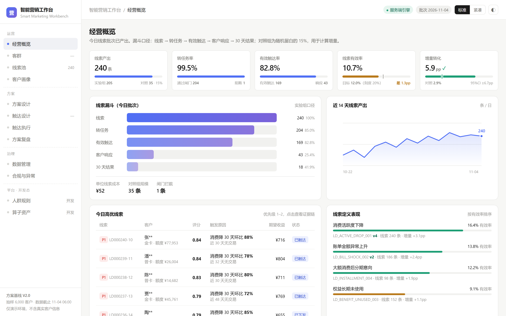

# 智能营销工作台 · Smart Marketing Workbench

用线索定义 DSL 圈人，经合规闸门下发方案与任务单，触达回执回流后按实验/对照组复盘增量——所有状态变更写入 sha256 审计链，前后端共用同一份规则引擎。



零外部依赖 · 零构建步骤 · 零数据库 · Node.js ≥ 18 · 89 个后端用例通过

---

## 项目简介

**这是什么。** 一套面向银行零售营销场景的可运行演示工作台，原本是本地 AI Harbor 平台的一个分区，现抽取为独立仓库。它把「规则圈人 → 客群 → 方案 → 任务单 → 触达 → 回执 → 结果 → 复盘」串成一条闭环，重点不在页面好不好看，而在**每一次状态变更都有依据、有闸门、有留痕**。

**解决什么问题。** 营销动作散落在 Excel、话术脚本和人工记录里时，「谁被圈进来、凭什么给他这个权益、哪一步被合规拦下、转化到底是活动带来的还是本来就会发生」都无法回放。本工作台把这些环节收敛到一条有版本、有审计、有对照组的数据链上。

**怎么做的。** 浏览器端 12 个视图通过 `/api/smart-marketing/*` 读写服务端状态；全部业务计算放在一份 UMD 包装的 `engine.js` 里，Node 与浏览器加载的是**同一个文件**，避免两端口径漂移。线索下发前过 G1–G7 合规闸门，方案/任务单各有一套显式状态机，触达回执回流后计算实验组与对照组的转化率差及置信区间。LLM 相关能力（外呼话术、线索解释、方案草稿、通话质检）在模型不可用时一律降级为确定性模板，闭环本身不依赖模型服务。

**交付物与状态。** 仓库包含完整前端（8,015 行单文件）、共享引擎（1,092 行）、HTTP 路由（1,797 行）、7 个服务模块、3 个测试文件和一个最小宿主服务。数据为确定性种子生成的演示数据（6,000 客户 / 240 条线索，`seed=20261104`），健康检查明确返回 `simulated: true`，**不含真实客户信息，不作为经营决策依据**。当前版本是从平台抽取的快照，不是生产系统；已知缺陷见文末，未做修改即推送。

---

## 名词表

先对齐术语，再看机制。带链接的定义来自该术语的官方/原始出处，不是本项目自造的解释。

| 名词 | 含义 |
|---|---|
| `smart-marketing` | 本仓库的技术标识，同时是目录名、静态路径 `/tools/smart-marketing/`、API 前缀 `/api/smart-marketing/*`；展示名为「智能营销工作台 / Smart Marketing Workbench」。 |
| **DSL**（Domain-Specific Language，领域特定语言） | 面向特定问题域、而非通用编程的计算机语言，Martin Fowler 的[定义与内外部分类](https://www.martinfowler.com/bliki/DomainSpecificLanguage.html)。本项目用外部 DSL `lead_def:` 描述线索规则，有自定义语法与解析器（`/dsl/compile`）。 |
| **UMD**（Universal Module Definition） | 让同一个 JS 模块在浏览器全局、AMD 与 CommonJS 环境都能加载的模式，[umdjs/umd](https://github.com/umdjs/umd) 是其规范仓库。`engine.js` 用 UMD 包装，因此服务端 `require()` 与前端 `<script>` 得到同一份实现。 |
| **LogicFlow** | 滴滴开源的[业务流程图编辑框架](https://site.logic-flow.cn/)，提供节点/边的交互编辑与自定义扩展。本仓库唯一第三方前端库，用于「触达设计」页的话术流程画布，从 CDN 加载。 |
| **uplift modeling / 因果增量** | 估计「某个动作对个体行为的增量影响」的因果机器学习方法，区别于预测谁会响应；[NeurIPS 论文](http://papers.neurips.cc/paper/8198-uplift-modeling-from-separate-labels.pdf)给出的定义是估计 individual uplift / CATE，标准 A/B 测试只给平均处理效应。**本项目的 `inc` 指标不是 uplift model**，实现口径见「已知限制」。 |
| **G1–G7 合规闸门** | 本项目内部的七道拦截规则编号（含投诉客户、协商还款中客户、可解释性为 NONE 的算子不得进入对客场景等），非外部行业标准。 |
| **T / C 组** | 代码里线索的 `group` 字段：`T` 为实验组、`C` 为对照组，用于复盘页的组间对比。 |
| **sha256 审计哈希链** | 本项目实现：每条审计记录带前序哈希，用于检测记录被篡改；审计数组固定保留最近 500 条。 |

---

## 快速开始

```bash
git clone https://github.com/wanshoulu/smart-marketing.git
cd smart-marketing
node server.js
```

打开 <http://127.0.0.1:3000/>（会重定向到工作台）。不需要 `npm install`、不需要构建、不需要数据库——运行时只用到 Node 内置模块。

```bash
curl http://127.0.0.1:3000/api/smart-marketing/health   # 确认服务端引擎已接管
node --test tests/*.test.js                             # 跑 89 个后端用例
```

右上角显示 **服务端引擎** 表示 API 正常；若后端不可达，前端会切换为 **本地降级**，改用浏览器内的 `engine.js` 继续离线演示，但此时写入不会持久化。

需要修改端口：`PORT=3018 node server.js`。需要真实模型：复制 `.env.example` 为 `.env`，填写 `LLM_DIRECT_*`，细节见「配置」。

---

## 页面与能力

侧栏 4 组共 12 个视图，通过 hash 路由切换（`#overview`、`#scripts` 等）。

| 分组 | 视图 | 作用 |
|---|---|---|
| 经营 | 经营概览 | KPI、线索漏斗、趋势、高优线索、线索定义效果排名 |
| 经营 | 客群 / 线索池 | 可复用名单资产；线索列表与动作流转（下发/触达/响应/转化/关闭） |
| 经营 | 客户画像 | 单客户六维能力雷达、标签与风险提示 |
| 方案 | 方案设计 | 定人群、权益、渠道、预算，提交审批 |
| 方案 | 触达设计 | 外呼话术三引擎（rule / llm / agent）、流程画布、模拟通话、三引擎对比 |
| 方案 | 触达执行 | 拆任务单、下发、回执回流 |
| 方案 | 方案复盘 | 转化、增量口径、A/B 实验 |
| 治理 | 数据管理 | 数据集上传/预览/激活、复位演示链路 |
| 治理 | 合规与异常 | AI 应用登记、闸门统计、告警 |
| 平台·开发态 | 人群规则 / 算子资产 | DSL 编译与发布、算子登记与可解释性回溯 |

---

## 核心机制

- **单源规则引擎**：`tools/smart-marketing/engine.js` 是唯一计算口径，路由文件头注释明确「任何复制第二份计算逻辑的改动都视为缺陷」。
- **线索定义 DSL**：`lead_def:` 下声明 `scope`、`trigger`、`filters[]`、`scoring[]`、`threshold`、`cooldown_days`、`action`、`guardrail`，编译后实例化为客群。
- **G1–G7 闸门**：`engine.js` 的 `gatesOf()` 在「已下发」前拦截，失败返回 `gate_blocked`，并写入审计。
- **三套状态机**：线索 `待指认→已下发→已触达→已响应→已转化→已关闭`；方案 `草稿→待审批→已批准→排期中→执行中→已完成`；任务单 `草稿→待审批→已批准→执行中→（已暂停/已完成/已终止）`。
- **回执回流**：任务单 `/receipts` 汇总后推进方案状态，结果 `/outcomes` 供复盘页消费。
- **实验/对照与增量口径**：线索按 `group: 'T' | 'C'` 分流，`/metrics` 返回组转化率、差值 `inc` 与置信区间。
- **审计哈希链**：`routes/smart-marketing-api.js` 用 sha256 串接审计记录；`persist()` 采用 200 ms 防抖 + 临时文件 + `renameSync` 原子替换，避免半文件写入。
- **事实约束的 LLM 输出**：Agent 提示词要求只能使用输入事实里的数字、不得编造、禁用「保本/稳赚/无风险/承诺收益」等词，必须走 `emit_lead_explanation` / `emit_campaign_draft` 工具函数输出；违规即降级模板。
- **三阶段外呼引擎**：`rule`（规则流程）、`llm`（模型生成）、`agent`（模型主导命令），`/scripts/compare` 并排对比；阶段三 `sanitizeCommands` 强制 `close_success` 降级为 `confirm_info` 直到客户确认。
- **本地降级**：`/health` 探活失败时，前端 `bootstrap()` 回落到浏览器内 `E.aggregate()`，计算口径不变，只是写入不落盘。

完整设计取舍见 [docs/architecture.md](docs/architecture.md)，端点与字段见 [docs/api.md](docs/api.md)。

---

## 目录结构

```
smart-marketing/
├── server.js                       # 最小宿主：.env、API 分发、静态托管（本仓库新增）
├── package.json                    # start / test 脚本，无运行时依赖
├── .env.example                    # 可选配置项，无真实密钥
├── tools/smart-marketing/
│   ├── index.html                  # 前端：12 视图 + 内联 CSS/JS（8,015 行）
│   └── engine.js                   # 共享引擎（UMD，1,092 行）
├── routes/smart-marketing-api.js   # HTTP 编解码 + 持久化 + 状态机把关
├── services/smart-marketing/       # dialog / tasks / agents / datasets / tags / agent-llm / real-llm
├── config/api-keys.js              # 模型路由注册表（密钥一律从环境变量读取）
├── data/smart-marketing/state.json # 演示初始状态；POST /demo/reset 可复位
├── tests/                          # 3 个 node:test 测试文件
└── docs/                           # architecture.md / api.md / screenshots/
```

---

## 配置

所有配置都是可选的，不填也能跑通完整演示闭环。复制 `.env.example` 为 `.env` 后按需填写；`.env` 已在 `.gitignore` 中，不要提交真实密钥。

| 变量 | 作用 | 不配置的后果 |
|---|---|---|
| `PORT` | HTTP 端口，默认 `3000` | — |
| `LLM_DIRECT_BASE` / `LLM_DIRECT_KEY` / `LLM_DIRECT_MODEL` | 直连任意 OpenAI 兼容端点 | 外呼话术走确定性模拟 |
| `SMART_MKT_REAL_LLM=off` | 强制关闭真实 LLM | — |
| `SM_MODEL_ENDPOINT` | Agent 解释/方案草稿/质检的服务地址 | 默认指向 `127.0.0.1:3000` 的网关，本仓库不含该网关，会降级模板 |
| `AI_BANK_AGENT_RUNTIME_TOKEN` | 自建网关的服务令牌 | — |
| `QWEN_KEY` | 语义向量召回（`text-embedding-v4`） | 回落关键词召回 |

> 原平台的内部模型网关 `/api/ai-bank/v1/internal/model/v1/chat/completions` 不在此仓库内。这是抽取时刻意保留的边界：本仓库不伪装成模型服务，也不内置任何密钥。

---

## 测试

```bash
node --test tests/*.test.js
```

本次实测：**89 / 89 通过，0 失败，约 0.27 秒**（Node.js v22.22.2，Windows，`node --test tests/*.test.js`）。覆盖 `engine`（34）、`agent`（12）、`dialog`（43），包括闸门 G5 对协商还款中客户的拦截、可解释性为 NONE 的算子不得进入对客场景、算子元数据完整性等。

口径说明：这 89 个用例全部是后端逻辑测试，**前端 6,164 行内联 JS 没有测试覆盖**，测试全绿不等于页面无缺陷（见下节）。

---

## 设计取舍与代价

| 决策 | 得到 | 代价 |
|---|---|---|
| 前端全部内联在单个 `index.html`（8,015 行） | 零构建、无打包器、静态服务器直接托管 | 无法模块化与 tree-shaking，diff 噪声大，前端难以单测 |
| `engine.js` 用 UMD 前后端同源 | 前后端指标口径不会漂移，一致性可测 | 引擎内禁用 `document`/`window`/Node 内置模块；`rnd()` 调用顺序决定全部数据，新增任何调用都会让已比对指标失真，必须同步升 `ENGINE_VERSION` 并重跑一致性测试 |
| 状态存单个 `state.json` | 零运维、可用文本 diff 审阅全过程 | 无事务与并发写保护、无备份轮转、审计固定截断 500 条、单文件约 228 KB |
| 确定性种子数据 | 每次演示结果一致，可复现 | 演示数据不是经营数据；接入真实数仓须重跑全部口径 |
| LLM 失败一律降级模板 | 断网、无密钥时闭环仍可演示 | 输出不含模型生成内容；且降级是静默的，容易误判为「模型在工作」 |
| LogicFlow 从 CDN 加载 | 不打包第三方依赖 | 内网/离线部署时话术流程画布不可用 |
| 抽出最小 `server.js` | 脱离原平台三行命令跑起来 | 不含原平台门户、模型网关与其它工具分区；该宿主是本仓库新写的，不是原平台代码 |

---

## 已知限制

这些是从代码里核实、且部分已在本地复现的问题，推送时**保持原样未修改**，便于对照原平台。

1. **`/cases` 端点失效**：`tools/smart-marketing/index.html:7295` 调用 `api('/cases')`，后端只实现了 `/scripts/cases`（`routes/smart-marketing-api.js:1406`）；请求落到 404 兜底，前端 `catch` 吞掉错误，试跑记录列表静默不更新。
2. **风险优先级整套失效**：`index.html:1903-1905` 把状态包装成对象，而 `:1891-1901` 的 11 条规则用 `s === '已暂停'` 这类对象与字符串的严格比较，恒为 false。本地复现 `statusPriority('已暂停', {paused_reason:'complaint_redline'})` 返回 `{risk:0,...}` 而非「红线暂停 / risk 100」，影响 `:5166` 的状态标签着色。
3. **CORS 预检缺 DELETE**：`routes/smart-marketing-api.js:1751` 只声明 `GET, POST, PUT, OPTIONS`，但前端实际会发 `DELETE /definitions/:id` 与 `DELETE /scripts/:id`。同源 iframe 下不触发预检，跨域部署会失败。
4. **模型网关端口两处取法不一致**：`agents.js:17` 写死 `127.0.0.1:3000`，`real-llm.js:29` 用 `PORT || 3000`；用非 3000 端口启动时 Agent 解释/质检会静默降级。
5. **复盘口径**：页面称「因果增量」，实现是实验组/对照组转化率之差与置信区间，并未做 uplift model 的个体级 CATE 估计；引用该术语时不要按论文的严格含义理解。
6. **界面口径与实现口径**：侧栏写「每日批」，实际 `AUTO_REFRESH_MS = 5 * 60 * 1000`（演示压成 5 分钟一轮）；素材为占位图，代码注明生产环境需接素材系统。
7. **无鉴权、无租户隔离、无 CSRF 防护**：设计目标是本机演示，不要直接暴露到公网。
8. **状态文件单点**：无并发写保护、无历史版本、无备份轮转，审计固定保留最近 500 条。
9. **无 CI、无 Dockerfile、无浏览器端自动化测试**：本仓库只提供 `node server.js` 这一种运行方式。
10. **未选定开源许可证**：`package.json` 标为 `UNLICENSED`。若要允许他人使用，请先补充 `LICENSE`。

---

## 与 AI Harbor 平台的关系

`tools/`、`routes/`、`services/`、`config/`、`data/`、`tests/` 下的文件是从本地 AI Harbor 平台实例**逐字节抽取**的，未改动任何一行代码。本仓库新增的只有运行壳与文档：`server.js`、`package.json`、`.env.example`、`.gitignore`、`README.md`、`docs/`。

在原平台里，工作台通过门户 `index.html` 的 iframe 挂载到 `/tools/smart-marketing/`，API 由平台 `server.js` 分发；这里用一个 100 行左右的最小宿主替代了那部分职责。因此**本仓库可独立运行，但不等于原平台的完整部署**，Docker 编排、门户分区和模型网关都不在范围内。

---

## License

尚未指定开源许可证（见「已知限制」第 10 条）。代码与文档目前仅供查看与本地运行。
