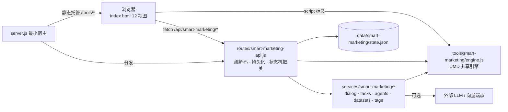

# 架构与设计记录

本文说明「为什么这样设计、边界在哪」。项目简介与最短上手路径见 [README](../README.md)，端点清单见 [API 文档](api.md)。

## 1. 分层



职责边界写在 `routes/smart-marketing-api.js` 的文件头：路由层只做 HTTP 编解码、状态持久化、状态机把关；**全部业务算法在 `engine.js`**。任何在路由层复制第二份计算逻辑的改动都视为缺陷，因为前后端口径会漂移。

`services/` 是可替换的业务实现：对话流程、任务单状态机、Agent 解释、数据集、标签字典、两处 LLM 适配。`config/api-keys.js` 只是模型路由注册表，密钥一律从环境变量取。

## 2. 主数据流

```
lead_def DSL ──/dsl/compile──▶ 定义(definitions)
      │                            │
      │                     /definitions/:id/materialize
      ▼                            ▼
 filters + scoring + threshold ──▶ 线索(leads, group=T/C)
                                      │
                          /leads/:id/actions（先过 G1–G7 闸门）
                                      ▼
                         方案(campaigns) ──拆单──▶ 任务单(tasks)
                                                      │
                                        /tasks/:id/receipts（回执）
                                                      ▼
                                        结果(outcomes) ──▶ 复盘(effect / A/B)
```

每一步状态变更写入 `audit`，记录带前序 sha256 哈希。复盘页的结果用于迭代下一轮线索定义，形成闭环——这也是「工作台」而非「活动管理页」的界限。

## 3. 三套状态机

| 实体 | 合法迁移 | 把关点 |
|---|---|---|
| 线索 | `待指认 → 已下发 → 已触达 → 已响应 → 已转化 → 已关闭`；任意态可 `→ 已关闭` | `已下发` 前调用 `gatesOf()`，失败返回 `gate_blocked`；`engine.js` 的 `transitionsOf()` / `setLeadStatus()` |
| 方案 | `草稿 → 待审批 → 已批准 → 排期中 → 执行中 → 已完成`，旁支 `已终止` | `transitionCampaign()`；任务单全结束时由 `tasks.js` 自动推进 |
| 任务单 | `草稿 → 待审批 → 已批准 → 执行中 →（已暂停 / 已完成 / 已终止）` | `已暂停 → 执行中` 需校验 `paused_reason === 'complaint_redline'` |

`lead_status` 是状态覆盖表而非线索副本：引擎重启后按它回放，不重写引擎里的种子数据。

## 4. 共享引擎的约束

`engine.js` 用 UMD 包装，被 Node 的 `require()` 和浏览器的 `<script>` 同时加载。为此文件头规定：纯函数 + 内存状态，禁止引用 Node 内置模块、`document`、`window`。

一个容易被忽略的耦合：`rnd()` 的调用顺序决定全部演示数据与聚合指标。新增任何一次调用都会让前后端已比对的指标失真，因此改引擎必须同步升 `ENGINE_VERSION` 并重跑一致性测试。这条约束写在 `engine.js` 头注释里，属于设计决定而非实现细节。

前端 `api()` 统一封装 fetch，错误对象带 `status` / `code` / `payload`；`bootstrap()` 先探 `/health`，成功后并行拉 `/metrics`、`/definitions`、`/compliance`、`/audit?limit=50`、`/fields`，页面右上角显示「服务端引擎」。任一失败置 `API_OK=false`，改用本地 `E.aggregate()` 并显示「本地降级」。降级只改变「谁能改状态」，不改变「怎么算」。

## 5. 持久化与审计

- 单一文件 `data/smart-marketing/state.json`，顶层键见 README 目录结构说明。
- `persist()`：200 ms 防抖 → 写 `state.json.tmp` → `renameSync` 原子替换。Node 单线程同步写，规避半文件写入。
- `load()` 与写入时都把 `audit` 截断到最近 500 条（`routes/smart-marketing-api.js:217`、`:289`）。
- 客群自动刷新：`AUTO_REFRESH_MS = 5 * 60 * 1000`，注释说明生产是每日 04:00 批，演示压成 5 分钟一轮，`refresh_mode=manual` 的客群跳过。
- 演示复位：`POST /api/smart-marketing/demo/reset`。

**代价**：无事务、无并发写保护、无备份轮转、无历史版本。这是为了让整个仓库能用文本 diff 审阅、且零运维跑起来；它不适合多实例写入。

## 6. LLM 通路与降级矩阵

| 通路 | 模块 | 用途 | 失败行为 |
|---|---|---|---|
| 外呼实时生成 | `real-llm.js` | 意图识别 JSON、话术（≤90 字、不承诺材料外权益、不索密码），温度 0.2、超时 12 s | 一次重试后回落确定性模拟，`trace.real=false` |
| 阶段三命令 | `agent-llm.js` | 输出 `{act,say,set_slot,tool}`；`sanitizeCommands` 强制 `close_success → confirm_info` | 命令不合法时按规则流程接管 |
| Agent 解释/草稿/质检 | `agents.js` | 必须走 `emit_lead_explanation` / `emit_campaign_draft` 工具函数输出；只能用输入事实里的数字 | 违规或超时 25 s 降级模板 |
| 语义向量召回 | `dialog.js` 调 `text-embedding-v4` | 话术知识库混合召回 | 回落关键词召回 |

`FORBIDDEN_WORDS` 拦截「保本 / 稳赚 / 无风险 / 必过 / 百分百 / 承诺收益 / 刚性兑付」；`STRUCTURAL_NUMBERS` 把「近 30 天」这类表述性数字与业务数字分开，避免白名单过严导致所有正常输出都被误判为编造。

**代价**：降级是静默的，界面不会明确告诉你「这次是模板不是模型」。原平台的内部模型网关不在本仓库内，因此开箱运行时 LLM 通路默认全部走降级路径。

## 7. 设计决策记录

| # | 决策 | 理由 | 代价 / 被否决的替代方案 |
|---|---|---|---|
| 1 | 业务算法只放一份 UMD 引擎 | 前后端指标必须同源，否则降级模式下数字会变 | 引擎不能碰 DOM/Node API；否决了「前端算展示、后端算权威」的常见做法 |
| 2 | 前端单文件内联 | 零构建，静态服务器直接托管，改完刷新即见 | 8,015 行难维护、前端零测试覆盖；否决了引入打包器（会给演示仓库增加安装步骤） |
| 3 | 状态用 JSON 文件而非数据库 | 演示闭环可完整 diff、可复位、零依赖 | 无并发/事务/备份；否决了 SQLite，理由是会给「三行跑起来」增加原生依赖 |
| 4 | 确定性种子数据 | 每次演示结果一致，测试可断言精确数值 | 不是真实经营数据；接入数仓需重跑全部口径 |
| 5 | LLM 全链路降级 | 断网、无密钥时闭环不中断 | 静默降级易误判；否决了「LLM 不可用就报错」 |
| 6 | 合规闸门前置到状态迁移 | 拦截发生在「已下发」之前，而不是事后审计 | 闸门逻辑与引擎耦合；否决了独立规则服务 |
| 7 | 抽取最小宿主 `server.js` | 脱离原平台独立可跑 | 不含门户/网关/其它分区；否决了把整个平台 server.js 搬过来（含大量无关模块与内部配置） |
| 8 | 不内置任何密钥与模型网关 | 公开仓库安全边界 | 真实 LLM 需使用者自行配置直连端点 |

## 8. 已知边界

README「已知限制」列出了已复现的缺陷与部署限制，此处不重复。补充两条结构性边界：

- **图表全自绘**：趋势、漏斗、六维雷达、DAG 都是模板字符串拼 `<svg>`，没有 ECharts / Chart.js / D3；唯一第三方前端库是 CDN 上的 LogicFlow。图表样式与数据生成逻辑耦合在 `index.html` 里。
- **演示规模**：引擎生成 6,000 客户、240 条初始线索，8 个算子、4 个定义效果、5 个 AI 应用、7 道闸门。这些是种子常量，不是性能基准；`simulated: true` 是健康检查里的明确声明。
